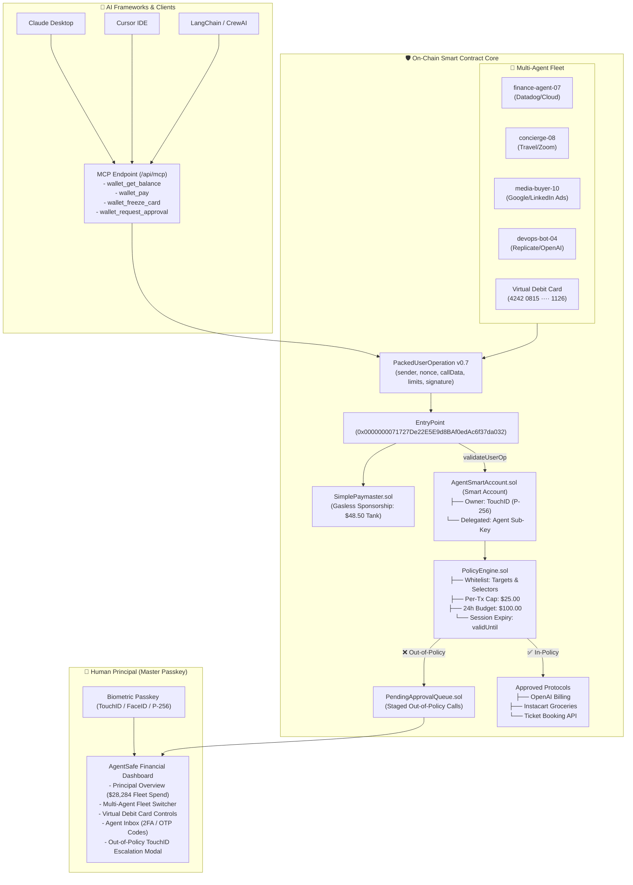

# 🛡️ AgentSafe: The Autonomous AI Agent Financial Infrastructure

> **Security and deployment status:** The dashboard and MCP payment tools are a local simulator. They update private JSON state and do not submit blockchain transactions, move real funds, issue cards, or verify biometrics. The Solidity contracts are separate and require deployment and integration before live use. The P-256 verifier's test bypass remains enabled and must never be used with real funds.

For local access, set a random `WALLET_ADMIN_TOKEN` of at least 32 characters in `frontend/.env.local`, then enter `owner` as the browser username and that token as the password. The HTTP API is locked when this variable is absent. Copy `data/wallet-state.example.json` to `data/wallet-state.json` for a fresh local state; the live state and all `.env` files are ignored by Git.

For on-chain recovery, deploy `SocialRecoveryModule` for the account owner, call `AgentSmartAccount.setRecoveryModule(module)` as the owner, then call `SocialRecoveryModule.bindAccount(account)` as the owner. Agent contract calls are currently limited to plain native transfers to allowlisted externally owned recipients; token and protocol calls require owner authorization until asset-specific policy decoders are implemented.

### Live copilot

The dashboard copilot uses `AZURE_OPENAI_API_KEY`, `AZURE_OPENAI_BASE_URL`, and `AZURE_OPENAI_MODEL` from `frontend/.env.local`. The Azure deployment must support Responses with `web_search_preview` or `web_search`. A normal lookup makes one model request to search and return up to three cited listings. Successful research is cached in each server process for 60 seconds with its original lookup time; **Refresh prices** bypasses the cache. All upstream work shares a 25-second deadline, with at most one retry for an explicit compatibility error. **Cancel lookup** aborts the request. Selecting a listing opens the merchant website for checkout. If search is unavailable, the copilot reports the error without substituting catalog prices or mock tickets. Card controls require an owner click and are never cached.

> **Track 02: Web3 & Blockchain (W3-02) — "Agent Wallet: Letting AI Agents Pay Safely"**  
> *A production-accurate ERC-4337 Account Abstraction smart-contract wallet and financial infrastructure providing autonomous AI agents with restricted, owner-defined session keys, virtual cards, connected inboxes, and Model Context Protocol (MCP) endpoints. Inspired by and compatible with [AgentWallet.ai](https://agentwallet.ai/), styled in the [EdVR](https://edvr.vercel.app/) Neo-Brutalist design language.*

---

## 🌟 The Core Problem

AI agents increasingly buy real goods and services for users: **OpenAI inference credits**, **grocery orders**, **cloud compute**, and **travel tickets**. However, giving an AI an unrestricted private key is financial suicide:
1. **Private Key Leaks**: Stolen keys allow attackers to drain 100% of the wallet to external addresses.
2. **Prompt Injection & Model Jailbreaks**: Malicious webpages or inputs can manipulate an LLM into calling unapproved phishing contracts.
3. **Runaway Overspending**: Buggy or looped agent workflows can rapidly drain funds.

**AgentSafe** solves this through full-stack financial infrastructure for AI agents backed on-chain by **ERC-4337 Account Abstraction**:
- **Human Principal (Master Admin)**: The verified owner (`Madhav B. · Chief Executive`) holding hardware-backed WebAuthn Biometric Passkeys (TouchID / Apple Secure Enclave / P-256 curve).
- **Multi-Agent Fleet**: Scoped sub-keys for specialized autonomous agents (`finance-agent-07`, `concierge-08`, `media-buyer-10`, `devops-bot-04`).
- **On-Chain Policy Engine (`PolicyEngine.sol`)**: Non-bypassable Solidity guardrails check every `UserOperation` before execution:
  1. **Allowed Contracts Whitelist** (OpenAI Billing, Instacart/Blinkit, Ticket Booking only)
  2. **Allowed Function Selectors** (only `payInvoice`, `orderCheckout`, `bookTicket`)
  3. **Max Per-Transaction Limit** (₹2,500 cap)
  4. **Rolling 24-Hour Daily Budget** with automatic epoch resets (₹10,000 default cap)
  5. **Allowed Recipient Whitelist** (blocks unauthorized external transfers)
  6. **Session Key Expiration** (`validUntil` block timestamp enforcement)
- **Agent-Linked Virtual Cards**: Tokenized Visa Business cards (`4242 0815 ···· 1126`) with programmable daily limits and instant freeze/unfreeze controls.
- **Model Context Protocol (MCP) Endpoint (`/api/mcp`)**: Standards-compliant Anthropic MCP JSON-RPC 2.0 server supporting `tools/list` and `tools/call` for Claude Desktop, Cursor, Devin, and LangChain.
- **Agent Communications Inbox**: Real-time 2FA SMS / OTP code receiver and merchant payment receipt log.
- **Two-Tier Escalation Queue (`PendingApprovalQueue.sol`)**: Out-of-policy actions halt execution and request Human Principal Passkey authorization.
- **Gasless Paymaster (`SimplePaymaster.sol`)**: Sponsoring gas in USDC so agents need zero native ETH.

---

## 🏛️ System Architecture



---

## 🎨 Visual Identity: EdVR Neo-Brutalism

- **Warm Ivory Canvas**: `#FDFBF7` canvas background.
- **Solid High-Contrast Borders**: Thick `border-2 border-black` and `border-3 border-black`.
- **Hard Offset Drop Shadows**: Zero-blur physical shadows (`shadow-[4px_4px_0px_#09090b]`, `shadow-[6px_6px_0px_#09090b]`, `shadow-[8px_8px_0px_#09090b]`).
- **Tactile Clay Buttons**: Real press physics (`brutal-btn`).
- **Punchy EdVR Color Palette**:
  - Crimson Red (`#E11D48` / `neoRed`)
  - Pastel Mint (`#A7F3D0` / `neoMint`)
  - Sunflower Yellow (`#FEF08A` / `neoYellow`)
  - Pastel Sky (`#BAE6FD` / `neoSky`)
  - Pastel Lavender (`#DDD6FE` / `neoPurple`)
  - Pastel Rose (`#FECDD3` / `neoRose`)

---

## 💥 Live Security Threat & Misbehavior Sandbox

Built specifically to prove smart-contract resilience to hackathon judges:
1. 🔴 **Leaked Key Drain Attack**: An attacker steals the agent's key and attempts to transfer $1,000 to an external address $\rightarrow$ **Smart Account reverts on-chain (`RecipientNotAllowed`)**.
2. 🔴 **Prompt Injection Attack**: An attacker injects a prompt tricking the agent into calling an unverified contract $\rightarrow$ **Smart Account reverts on-chain (`TargetNotAllowed`)**.
3. 🔴 **Overspend Panic**: Agent attempts a $145 flight booking on a $25 limit $\rightarrow$ **Smart Account halts execution and triggers Owner Passkey (TouchID) approval modal**.
4. 🔴 **Expired Key Attack**: Agent attempts a transaction after the 6-hour session window $\rightarrow$ **EntryPoint rejects operation (`PolicyExpired`)**.

---

## 🚀 Quickstart & Verification

### 1. Smart Contract Test Suite
Verify that all Solidity contracts compile and all 10 security test cases pass:
```bash
cd contracts
npm test
```

### 2. Frontend Wallet Dashboard & MCP Server
Run the Next.js 14 interactive agent wallet interface:
```bash
cd frontend
npm run dev
```
Open **[http://localhost:3000](http://localhost:3000)** in your browser.

### 3. Model Context Protocol (MCP) Endpoint
Test the MCP endpoint with curl:
```bash
curl -u owner -X POST http://localhost:3000/api/mcp \
  -H "Content-Type: application/json" \
  -d '{"jsonrpc": "2.0", "id": 1, "method": "tools/list"}'
```

---

## 📂 Repository Structure

```
PinkPathers/
├── contracts/                     # Smart Contract Suite
│   ├── src/
│   │   ├── account/
│   │   │   ├── AgentSmartAccount.sol      # ERC-4337 smart wallet with Passkeys & Session Keys
│   │   │   └── AgentAccountFactory.sol    # Deterministic CREATE2 factory
│   │   ├── policy/
│   │   │   ├── PolicyEngine.sol           # 6 policy checks, per-tx & 24h rolling budget
│   │   │   └── PendingApprovalQueue.sol   # Staging queue for out-of-policy requests
│   │   ├── paymaster/
│   │   │   └── SimplePaymaster.sol        # Gas sponsorship paymaster
│   │   ├── verifier/
│   │   │   └── P256Verifier.sol           # WebAuthn secp256r1 signature verification
│   │   └── mock/
│   │       ├── MockERC20.sol              # Mock USDC & ERC-20 tokens
│   │       └── MockPerpDEX.sol            # Mock protocol target
│   └── test/
│       ├── runTests.js                    # Solc compilation test runner
│       └── policyAndExecutionTest.js      # 10 comprehensive security test cases
│
├── frontend/                      # Next.js 14+ Wallet Dashboard
│   ├── src/
│   │   ├── app/
│   │   │   ├── api/mcp/route.ts           # Model Context Protocol (MCP) JSON-RPC 2.0 endpoint
│   │   │   ├── layout.tsx                 # Root layout & neo-brutalist styling
│   │   │   ├── page.tsx                   # Main Agent Wallet workspace & tabs
│   │   │   └── globals.css                # Tailwind CSS & EdVR brutal utilities
│   │   ├── components/
│   │   │   ├── WalletHeader.tsx           # Smart Account address, Paymaster tank & Passkey
│   │   │   ├── WalletBalancesCard.tsx     # Treasury balances & 24h budget meter
│   │   │   ├── PrincipalFleetOverview.tsx # Master Principal & Multi-Agent Fleet Directory
│   │   │   ├── AgentVirtualCard.tsx       # 3D Neo-Brutalist virtual card with freeze toggle
│   │   │   ├── AgentInboxModal.tsx        # 2FA SMS / OTP code receiver and receipts
│   │   │   ├── McpIntegrationModal.tsx    # Claude Desktop & Cursor MCP config & tool runner
│   │   │   ├── LiveActivityStream.tsx     # Real-time streaming activity feed
│   │   │   ├── InteractiveCliTerminal.tsx # ~/agentwallet — bash terminal sequence
│   │   │   ├── AgentKeyPolicyCard.tsx     # 6-dimension on-chain policy guardrails
│   │   │   ├── AgentActionSimulator.tsx   # Interactive simulator (API, Groceries, Tickets)
│   │   │   ├── ThreatDefensePlayground.tsx# Chaos & exploit tests (Drain, Prompt Injection)
│   │   │   ├── UserOpActivityTable.tsx    # ERC-4337 mempool & UserOp activity log
│   │   │   ├── OwnerApprovalModal.tsx     # Biometric TouchID Passkey approval modal
│   │   │   ├── PolicyConfigModal.tsx      # Sliders for limits and session duration
│   │   │   └── UserOpInspectorModal.tsx   # Raw packed ERC-4337 struct inspector
│   │   └── lib/
│   │       └── web3/
│   │           └── agentWalletClient.ts   # WebAuthn Passkeys, Fleet, Cards & UserOp dispatcher
│   ├── tailwind.config.js
│   └── tsconfig.json
└── README.md
```

---

<div align="center">
<b>AgentSafe · Built for Track 02: Web3 & Blockchain · Hackathon 2026</b>
</div>
