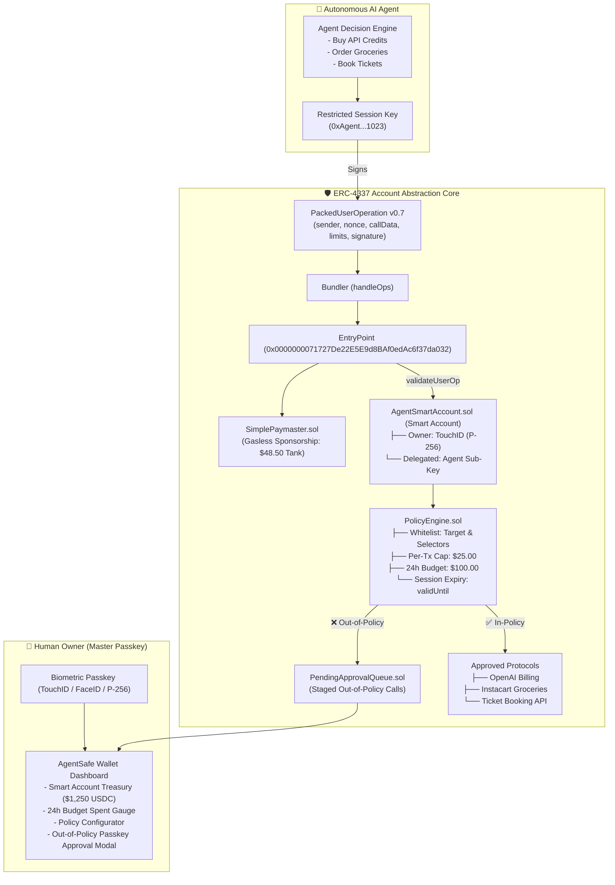

# 🛡️ AgentSafe: The ERC-4337 Smart Wallet for Autonomous AI Agents

> **Track 02: Web3 & Blockchain (W3-02) — "Agent Wallet: Letting AI Agents Pay Safely"**  
> *A production-accurate ERC-4337 Account Abstraction smart-contract wallet providing AI agents with restricted, owner-defined session keys. Secures autonomous payments (API credits, groceries, travel tickets) on-chain with WebAuthn Biometric Passkeys (TouchID / FaceID) and owner escalation.*

---

## 🌟 The Core Problem

AI agents increasingly buy real goods and services for users: **OpenAI inference credits**, **grocery orders**, **cloud compute**, and **travel tickets**. However, giving an AI an unrestricted private key is financial suicide:
1. **Private Key Leaks**: Stolen keys allow attackers to drain 100% of the wallet to external addresses.
2. **Prompt Injection & Model Jailbreaks**: Malicious webpages or inputs can manipulate an LLM into calling unapproved phishing contracts.
3. **Runaway Overspending**: Buggy or looped agent workflows can rapidly drain funds.

**AgentSafe** solves this on-chain at the smart contract level using **ERC-4337 Account Abstraction**:
- **Delegated Session Keys**: The agent holds an ephemeral, restricted sub-key.
- **On-Chain Policy Engine**: Non-bypassable Solidity guardrails check every `UserOperation` before execution:
  1. **Allowed Contracts Whitelist** (e.g. OpenAI Billing, Instacart/Blinkit, Ticket Booking only)
  2. **Allowed Function Selectors** (e.g. only `payInvoice`, `orderCheckout`, `bookTicket`)
  3. **Max Per-Transaction Limit** ($25.00 cap)
  4. **Rolling 24-Hour Daily Budget** with automatic epoch resets ($100.00 cap)
  5. **Allowed Recipient Whitelist** (blocks unauthorized external transfers)
  6. **Session Key Expiration** (`validUntil` timestamp enforcement)
- **WebAuthn Biometric Passkeys (P-256 Curve)**: The Human Owner holds the master key backed by device hardware security (Apple Secure Enclave, TouchID, FaceID).
- **Two-Tier Escalation Queue**: Out-of-policy actions (e.g. attempting to book a $145 flight on a $25 per-tx cap) are halted on-chain and staged in `PendingApprovalQueue.sol`, requesting the Owner's TouchID biometric authorization.
- **Gasless Paymaster**: The agent needs zero native ETH; all valid transactions are sponsored by `SimplePaymaster.sol`.

---

## 🏛️ System Architecture



---

## 💥 Live Security Threat & Misbehavior Sandbox

Built specifically to prove smart-contract resilience to hackathon judges:
1. 🔴 **Leaked Key Drain Attack**: An attacker steals the agent's key and attempts to transfer $1,000 to an external address $\rightarrow$ **Smart Account reverts on-chain (`RecipientNotAllowed`)**.
2. 🔴 **Prompt Injection Attack**: An attacker injects a prompt tricking the agent into calling an unverified contract $\rightarrow$ **Smart Account reverts on-chain (`TargetNotAllowed`)**.
3. 🔴 **Overspend Panic**: Agent attempts a $145 flight booking on a $25 limit $\rightarrow$ **Smart Account halts execution and triggers Owner Passkey (TouchID) approval modal**.
4. 🔴 **Expired Key Attack**: Agent attempts a transaction after the 6-hour session window $\rightarrow$ **EntryPoint rejects operation (`PolicyExpired`)**.

---

## 🚀 Quickstart & Verification

### 1. Smart Contract Test Suite
Verify that all Solidity contracts compile and all 10 security test cases pass:
```bash
cd contracts
npm test
```

### 2. Frontend Wallet Dashboard
Run the Next.js 14 interactive agent wallet interface:
```bash
cd frontend
npm run dev
```
Open **[http://localhost:3000](http://localhost:3000)** in your browser.

---

## 📂 Repository Structure

```
PinkPathers/
├── contracts/                     # Smart Contract Suite
│   ├── src/
│   │   ├── account/
│   │   │   ├── AgentSmartAccount.sol      # ERC-4337 smart wallet with Passkeys & Session Keys
│   │   │   └── AgentAccountFactory.sol    # Deterministic CREATE2 factory
│   │   ├── policy/
│   │   │   ├── PolicyEngine.sol           # 6 policy checks, per-tx & 24h rolling budget
│   │   │   └── PendingApprovalQueue.sol   # Staging queue for out-of-policy requests
│   │   ├── paymaster/
│   │   │   └── SimplePaymaster.sol        # Gas sponsorship paymaster
│   │   ├── verifier/
│   │   │   └── P256Verifier.sol           # WebAuthn secp256r1 signature verification
│   │   └── mock/
│   │       ├── MockERC20.sol              # Mock USDC & ERC-20 tokens
│   │       └── MockPerpDEX.sol            # Mock protocol target
│   └── test/
│       ├── runTests.js                    # Solc compilation test runner
│       └── policyAndExecutionTest.js      # 10 comprehensive security test cases
│
├── frontend/                      # Next.js 14+ Wallet Dashboard
│   ├── src/
│   │   ├── app/
│   │   │   ├── layout.tsx                 # Root layout & dark styling
│   │   │   ├── page.tsx                   # Main Agent Wallet workspace
│   │   │   └── globals.css                # Tailwind CSS
│   │   ├── components/
│   │   │   ├── WalletHeader.tsx           # Smart Account address, Paymaster tank & Passkey
│   │   │   ├── WalletBalancesCard.tsx     # Treasury balances & 24h budget meter
│   │   │   ├── AgentKeyPolicyCard.tsx     # 6-dimension on-chain policy guardrails
│   │   │   ├── AgentActionSimulator.tsx   # Interactive simulator (API, Groceries, Tickets)
│   │   │   ├── ThreatDefensePlayground.tsx# Chaos & exploit tests (Drain, Prompt Injection)
│   │   │   ├── UserOpActivityTable.tsx    # ERC-4337 mempool & UserOp activity log
│   │   │   ├── OwnerApprovalModal.tsx     # Biometric TouchID Passkey approval modal
│   │   │   ├── PolicyConfigModal.tsx      # Sliders for limits and session duration
│   │   │   └── UserOpInspectorModal.tsx   # Raw packed ERC-4337 struct inspector
│   │   └── lib/
│   │       └── web3/
│   │           └── agentWalletClient.ts   # WebAuthn Passkeys & UserOperation dispatcher
└── README.md
```

---

<div align="center">
<b>AgentSafe · Built for Track 02: Web3 & Blockchain · Hackathon 2026</b>
</div>
