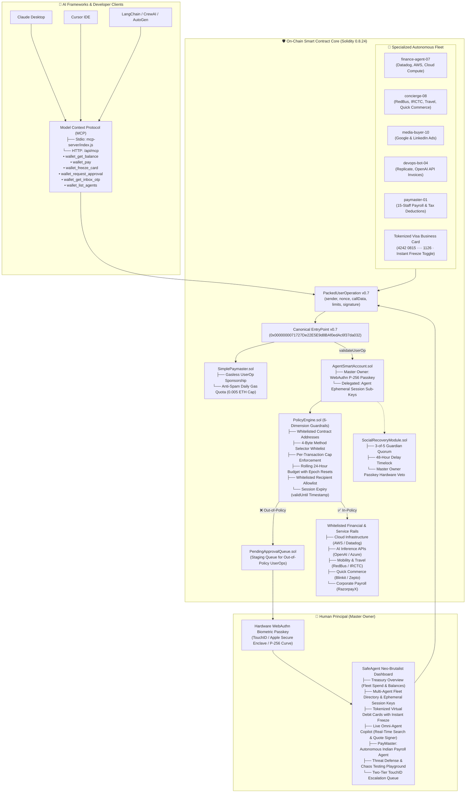

# 🏛️ SafeAgent Treasury: Autonomous AI Agent Financial Infrastructure

> **Track 02: Web3 & Blockchain (W3-02) — "Agent Wallet: Letting AI Agents Pay Safely"**  
> *A production-accurate ERC-4337 Account Abstraction smart account and financial operating system providing autonomous AI agents with restricted, owner-defined session keys, programmable virtual debit cards, real-time 2FA OTP inboxes, Model Context Protocol (MCP) toolkits, and an intelligent Live Copilot with PayMaster payroll automation.*  
> Inspired by and compatible with [AgentWallet.ai](https://agentwallet.ai/) & [Anthropic Model Context Protocol](https://modelcontextprotocol.io/), styled in the tactile [EdVR](https://edvr.vercel.app/) Neo-Brutalist design language.

---

## 🌟 The Core Problem

AI agents are rapidly moving from conversational assistants to economic actors: procuring **cloud infrastructure**, booking **travel and mobility**, settling **API and inference invoices**, and running **corporate payroll**. However, handing an autonomous AI agent an unconstrained private key is financial suicide:

1. **Private Key Leaks**: A single compromised sub-key gives attackers total control to drain 100% of the treasury to external hacker wallets.
2. **Prompt Injections & Model Jailbreaks**: Malicious external websites or adversarial inputs can trick an LLM into calling unwhitelisted phishing contracts.
3. **Runaway Loops & Micro-Drains**: Buggy agent code or infinite retry loops can burn through thousands of dollars in gas and capital within minutes.
4. **Lack of Human Oversight on Large Disbursements**: High-value transactions (such as ₹10 Lakhs payroll runs) occur with zero human principal verification.

**SafeAgent Treasury** eliminates these risks through an enterprise financial stack backed on-chain by **ERC-4337 Account Abstraction** and hardened off-chain with deterministic guardrails.

---

## 🏛️ System Architecture



---

## ⚡ Key Modules & Capabilities

### 1. 🤖 Live Omni-Agent Copilot (`LiveOmniAgentCopilot.tsx` & `/api/copilot/plan`)
- **Natural Language Intent Parsing**: Users can enter natural instructions such as:
  - *"Buy me a 1 kg pack of bananas in Bengaluru under ₹150"*
  - *"Transfer ₹500 to alex@upi"*
  - *"Find flights from Delhi to Bengaluru next Friday"*
  - *"Compare 27 inch 4K monitors under ₹30,000"*
  - *"Freeze the concierge card"*
- **Real-Time Live Web Search & Citations**: Connects to Azure OpenAI with web search capabilities, returning up to 3 cited merchant listings with verified price evidence, source URLs, and timestamps.
- **Fast Local Transfer Parser**: Direct amount and recipient instructions (e.g., `transfer ₹500 to user@upi` or complete 40-digit hex addresses) are parsed locally with zero model latency.
- **Cryptographic Server-Signed Quotes**: Purchases and transfers generate a tamper-proof 5-minute signed quote bound to the exact amount, recipient, listing, and delegated agent.
- **Atomic Settlement**: Checks active session validity, virtual card freeze status, and daily policy limits before atomically deducting simulated INR and recording verified receipts, activity logs, and inbox notifications.

### 2. 💼 PayMaster: Autonomous Indian Payroll Agent (`PayMasterPanel.tsx` & `/api/paymaster`)
- **Dedicated Payroll Workspace**: Manages 15 synthetic Indian employee profiles across major tech hubs (Bengaluru, Mumbai, Delhi, Hyderabad, Pune, Chennai, etc.).
- **Configurable Compensation Bands**: Pre-configured monthly gross salaries based on role standards:
  - *Engineers*: ₹60,000
  - *Designers*: ₹55,000
  - *Finance*: ₹50,000
  - *HR*: ₹45,000
  - *Operations*: ₹40,000
  - *Support*: ₹35,000
- **Authentic Indian Statutory Deductions**:
  - **Provident Fund (PF)**: 12% of Basic Pay (Basic = 40% of earned gross), capped at a ₹15,000 wage base.
  - **Professional Tax (PT)**: Flat ₹200 for positive monthly earnings.
  - **Tax Deducted at Source (TDS)**: Configurable per-employee percentage.
  - **Prorated Leave**: Deductions for unpaid leave beyond the standard allowance (2 paid leave days, 1 sick leave day).
- **Dual Verification Engine**:
  1. **AI Payslip Generation**: AI model computes net earnings and generates natural language explanations per employee.
  2. **Deterministic Arithmetic Guardrails**: Server validates every single calculation against strict formulas before approving the batch.
- **Treasury Safety**: Enforces batch spend limits (₹10,00,000 default), per-employee limits (₹1,00,000), duplicate-month payout blocks, immutable run history snapshots, and downloadable audit JSON files.

### 3. 🛡️ On-Chain Policy Engine (`PolicyEngine.sol`)
Non-bypassable Solidity smart contract guardrails evaluated directly during ERC-4337 `validateUserOp`:
1. **Target Whitelist**: Restricts calls strictly to approved protocol and vendor contracts.
2. **Method Selector Whitelist**: Only permits authorized 4-byte execution selectors (`payInvoice`, `orderCheckout`, `bookTicket`).
3. **Per-Transaction Cap**: Hard maximum value per UserOp (e.g., ₹2,500 or $25.00 limit).
4. **Rolling 24-Hour Daily Budget**: Automatically resets every 24-hour epoch without requiring manual contract owner interactions.
5. **Recipient Whitelist**: Rejects unauthorized external wallet transfers.
6. **Session Key Timestamp Expiry**: Rejects transactions past the `validUntil` block timestamp.

### 4. 💳 Tokenized Virtual Debit Cards (`AgentVirtualCard.tsx`)
- Scoped virtual Visa Business cards (`4242 0815 ···· 1126`) issued for each fleet agent.
- Visual 3D card display showing masked PAN, expiry date, CVV, and assigned cardholder name.
- Real-time spend meter tracking daily budget utilization.
- One-click **Instant Freeze / Unfreeze toggle** directly updating on-chain state and blocking all agent card checkouts.

### 5. 📨 Connected Agent Inbox & 3DS OTP Interceptor (`AgentInboxModal.tsx`)
- Inbound communication stream receiving SMS 2FA codes and merchant verification OTPs.
- Automatic OTP extraction for Visa 3DS 2.0 transactions, enabling fully autonomous checkout without human friction.
- Complete audit trail of past merchant transaction receipts with itemized metadata.

### 6. 🔌 Model Context Protocol (MCP) Integration (`mcp-server/` & `/api/mcp`)
- Standards-compliant Anthropic MCP JSON-RPC 2.0 protocol implementation.
- Dual-mode support:
  - **Stdio Transport** (`mcp-server/index.js`): Drop-in integration for **Claude Desktop** and **Cursor IDE**.
  - **HTTP Transport** (`frontend/src/app/api/mcp/route.ts`): Streamable API for cloud agent frameworks like LangChain, AutoGen, and CrewAI.
- **Exposed Tools**:
  - `wallet_get_balance`: Retrieve smart account balances, remaining daily budget, per-tx limit, and card status.
  - `wallet_pay`: Execute an in-policy payment validating all guardrails.
  - `wallet_freeze_card`: Instantly freeze or unfreeze an agent's virtual card.
  - `wallet_request_approval`: Stage an out-of-policy transaction for Master Passkey authorization.
  - `wallet_get_inbox_otp`: Fetch real-time 2FA OTP codes for 3DS verification.
  - `wallet_list_agents`: Enumerate fleet agents, active sessions, and budget allocations.

### 7. 🔐 Social Recovery & Owner Hardware Passkey Veto (`SocialRecoveryModule.sol`)
- **3-of-5 Guardian Quorum**: Initiates account recovery if an owner loses access.
- **48-Hour Delay Timelock**: Mandatory waiting period before recovered ownership is transferred.
- **Hardware Passkey Veto**: The master owner's hardware WebAuthn Passkey retains unilateral veto power to cancel rogue or premature recovery attempts at any time during the timelock window.

### 8. ⛽ Anti-Spam Gasless Paymaster (`SimplePaymaster.sol`)
- Sponsors gas for all valid agent UserOperations, eliminating the need for agents to hold native ETH.
- **Anti-Spam Daily Gas Quota**: Tracks gas usage per agent address and caps daily sponsorship at `MAX_DAILY_GAS_PER_AGENT = 0.005 ether`, preventing denial-of-wallet gas drain attacks.

---

## 🎨 Visual Identity: EdVR Neo-Brutalism

SafeAgent Treasury is crafted in the tactile **EdVR Neo-Brutalist** design language:
- **Warm Ivory Canvas**: `#FDFBF7` textured background for high legibility.
- **Solid High-Contrast Borders**: Thick, crisp `border-2 border-black` and `border-3 border-black` lines.
- **Zero-Blur Drop Shadows**: Physical hard offset shadows (`shadow-[4px_4px_0px_#09090b]`, `shadow-[6px_6px_0px_#09090b]`).
- **Tactile Clay Buttons**: Real press physics with active translate offsets (`translate-x-[2px] translate-y-[2px]`).
- **Signature Palette**:
  - Deep Emerald (`#123b32` / `#065f46`)
  - Warm Amber (`#d97706` / `#fef08a`)
  - Crimson Threat Red (`#e11d48`)
  - Clean Paper White (`#ffffff`)

---

## 💥 Live Security Threat & Misbehavior Sandbox

The built-in **Threat Defense Playground** allows judges and security auditors to test real adversarial attack vectors:

| Attack Vector | Simulated Attack Scenario | On-Chain Defense Mechanism | Result |
|---|---|---|---|
| **Prompt Injection** | LLM is tricked into transferring funds to an external attacker address (`0xdeadbeef`) | `PolicyEngine.sol` checks recipient allowlist; reverts with `TargetNotAllowed` | 🛡️ **REVERTED (Loss: ₹0)** |
| **Calldata Corruption** | Attacker invokes an unwhitelisted function selector on a target contract | 4-byte selector check fails; reverts with `SelectorNotAllowed` | 🛡️ **REVERTED (Loss: ₹0)** |
| **High-Frequency Micro-Drain** | Attacker executes 20 rapid micro-transactions to drain the treasury | Rolling 24-hour daily budget caps cumulative spend; reverts transaction #7 | 🛡️ **CAPPED AT DAILY LIMIT** |
| **Post-Expiry Sub-Key Call** | Compromised agent sub-key attempts action after session expiry | `validUntil` block timestamp check fails; reverts on-chain | 🛡️ **REVERTED (`PolicyExpired`)** |
| **Paymaster Gas Drain** | Attacker triggers failing transactions in an infinite loop to drain the gas tank | `SimplePaymaster.sol` enforces per-agent daily gas quota (`0.005 ETH`) | 🛡️ **GAS TANK PROTECTED** |
| **Rogue Guardian Takeover** | 3 colluding guardians attempt unauthorized account recovery | Master Owner executes hardware Passkey veto during the 48h timelock | 🛡️ **RECOVERY CANCELLED** |

---

## 🧪 Comprehensive Verification & Test Results

SafeAgent Treasury includes end-to-end automated testing across all layers:

### 1. Smart Contract Test Suite (`npm test` in `contracts/`)
```bash
cd contracts && npm test
```
- **12 Solidity Source Files Compiled Cleanly** with `solc v0.8.24`:
  - `AgentAccountFactory.sol`, `AgentSmartAccount.sol`, `PolicyEngine.sol`, `PendingApprovalQueue.sol`, `SimplePaymaster.sol`, `SocialRecoveryModule.sol`, `P256Verifier.sol`, etc.
- **Base Policy & Execution Tests**:
  - ✅ Passed: In-policy trade executes successfully within limits
  - ✅ Passed: Rejects transaction to unwhitelisted hacker/external target
  - ✅ Passed: Rejects call with unwhitelisted method selector (malicious calldata)
  - ✅ Passed: Rejects trade exceeding per-transaction cap ($150 > $100)
  - ✅ Passed: Rejects trade that exceeds remaining daily cumulative budget ($300 cap)
  - ✅ Passed: Resets daily budget when 24 hours have elapsed
  - ✅ Passed: Rejects excessive leverage beyond policy cap (5x > 3x)
  - ✅ Passed: Rejects derivative order missing mandatory stop-loss
  - ✅ Passed: Rejects action after session key validUntil timestamp
  - ✅ Passed: Halts all agent actions when drawdown circuit breaker triggers
- **5+ Hijack Attack Vectors Suite**:
  - ✅ Attack 1: Prompt Injection / Full Drain -> REVERTED (Loss: ₹0)
  - ✅ Attack 2: Malicious Calldata (0xdeadbeef) -> REVERTED (Loss: ₹0)
  - ✅ Attack 3: High-Frequency Micro-Drain -> 6 passed (₹9,000), 14 REVERTED at daily limit (Total Loss: ₹9,000 <= ₹10,000)
  - ✅ Attack 4: Post-Expiry Sub-Key Call -> REVERTED on-chain (Loss: ₹0)
  - ✅ Attack 5: Paymaster Infinite Gas Drain -> 5 sponsored (0.005 ETH), 10 REVERTED (Paymaster Tank Protected)
- **3-of-5 Guardian Social Recovery & Owner Veto**:
  - ✅ 3-of-5 Guardian Quorum Reached: 48-Hour Timelock Initiated
  - ✅ Premature Execution Reverted (24h < 48h)
  - ✅ Master Owner Hardware Passkey Veto Successful: Cancelled rogue recovery attempt
  - ✅ Recovery Finalized after 48h delay: Owner successfully transferred to recovered address
- **Property-Based Invariant Fuzzing Engine**:
  - 🎯 **10,000 randomized fuzz iterations completed**.
  - 📊 In-Policy / Owner Executions: 1,800
  - 🛡️ Blocked Adversarial / Out-of-Policy Attempts: 8,200
  - 🔒 **Invariant Violations: 0 / 10,000 (0.000%)**
  - ✅ Formal Invariant Proven: Funds move ONLY with valid owner or in-policy agent approval!

### 2. Frontend Automated Test Suites (`frontend/`)
```bash
cd frontend
npm run test:live-copilot    # Verified one-call lookup, cache/refresh/expiry, source validation, timeout & cancellation
npm run test:transactions    # Verified signed live quotes, direct transfers, atomic debit, retry idempotency & guardrails
npm run test:paymaster       # Verified 15 AI payslips, exact payroll math, duplicate-month lock, balance/card limits
npm run test:local-auth      # Verified local development auth and production token security lock
```

### 3. Model Context Protocol (MCP) Self-Test
```bash
node mcp-server/index.js --test
```
- ✅ `tools/list` successfully returned all 6 agent financial tools.
- ✅ `wallet_get_balance` verified against persistent smart account state.

---

## 🚀 Quickstart & How to Run

### 1. Prerequisites
- **Node.js**: v18.17.0 or later
- **npm**: v9.0.0 or later

### 2. Run the Next.js Frontend
```bash
cd frontend
npm install
npm run dev
```
Open **[http://localhost:3000](http://localhost:3000)** in your browser.

> **Local Development Note**: The development server binds to `127.0.0.1:3000`. In development mode, requests use an auto-generated signing secret without requiring manual configuration. For production deployments, set `WALLET_ADMIN_TOKEN` (minimum 32 characters) in your environment variables.

### 3. Configure Claude Desktop or Cursor for MCP
To connect Claude Desktop to SafeAgent Treasury, add this configuration to your `claude_desktop_config.json`:
```json
{
  "mcpServers": {
    "safeagent": {
      "command": "node",
      "args": ["/absolute/path/to/PinkPathers/mcp-server/index.js"]
    }
  }
}
```

Or connect via HTTP endpoint:
```bash
curl -X POST http://localhost:3000/api/mcp \
  -H "Content-Type: application/json" \
  -d '{"jsonrpc": "2.0", "id": 1, "method": "tools/list"}'
```

---

## 📂 Repository Structure

```
PinkPathers/
├── contracts/                             # ERC-4337 Smart Contract Core
│   ├── src/
│   │   ├── account/
│   │   │   ├── AgentSmartAccount.sol      # ERC-4337 Smart Account with WebAuthn P-256 & Session Keys
│   │   │   └── AgentAccountFactory.sol    # Deterministic CREATE2 Account Factory
│   │   ├── policy/
│   │   │   ├── PolicyEngine.sol           # 6-dimension on-chain guardrails & rolling 24h budget
│   │   │   ├── PendingApprovalQueue.sol   # Staging queue for out-of-policy requests
│   │   │   └── SocialRecoveryModule.sol   # 3-of-5 Guardian recovery with 48h delay & Owner Passkey veto
│   │   ├── paymaster/
│   │   │   └── SimplePaymaster.sol        # Gasless sponsorship with anti-spam daily quota
│   │   ├── verifier/
│   │   │   └── P256Verifier.sol           # WebAuthn secp256r1 signature verifier
│   │   ├── interfaces/                    # IAccount, IEntryPoint, IPaymaster, IRecoverableAgentAccount
│   │   └── mock/                          # MockERC20 & MockPerpDEX
│   └── test/
│       ├── runTests.js                    # Solc compilation and deployment runner
│       ├── policyAndExecutionTest.js      # 10 core policy security test cases
│       ├── hijackAttackSuite.js           # 5+ real-world hijack attack and recovery tests
│       └── invariantFuzzTest.js           # 10,000-iteration property-based invariant fuzzing engine
│
├── frontend/                              # Next.js 14+ Neo-Brutalist Treasury Dashboard
│   ├── src/
│   │   ├── app/
│   │   │   ├── api/
│   │   │   │   ├── copilot/
│   │   │   │   │   ├── plan/route.ts      # Live Copilot intent planning & search integration
│   │   │   │   │   └── transactions/route.ts # Signed quote validation and atomic settlement
│   │   │   │   ├── paymaster/route.ts     # PayMaster payroll batch calculation and disbursement
│   │   │   │   ├── wallet/state/route.ts  # Shared persistent wallet state bridge
│   │   │   │   └── mcp/route.ts           # HTTP Anthropic MCP JSON-RPC 2.0 endpoint
│   │   │   ├── layout.tsx                 # Root layout and font definitions
│   │   │   ├── page.tsx                   # Main dashboard workspace & 9-tab navigation
│   │   │   └── globals.css                # Tailwind CSS & EdVR Neo-Brutalist utility classes
│   │   ├── components/
│   │   │   ├── WalletHeader.tsx           # Smart Account address, Paymaster gas tank & Passkey status
│   │   │   ├── DashboardOverview.tsx      # Treasury summary cards and quick actions
│   │   │   ├── PrincipalFleetOverview.tsx # Multi-Agent fleet directory and session status
│   │   │   ├── AgentVirtualCard.tsx       # 3D interactive virtual debit card with freeze toggle
│   │   │   ├── LiveOmniAgentCopilot.tsx   # Live search, quote display, and purchase executor
│   │   │   ├── PayMasterPanel.tsx         # Detailed Indian payroll management and AI payslips
│   │   │   ├── AgentKeyPolicyCard.tsx     # On-chain PolicyEngine guardrails inspector
│   │   │   ├── AgentActionSimulator.tsx   # Manual transaction dispatcher and policy tester
│   │   │   ├── ThreatDefensePlayground.tsx# Live exploit and chaos testing sandbox
│   │   │   ├── Phase2HijackRecovery.tsx   # 3-of-5 Guardian social recovery walkthrough
│   │   │   ├── UserOpActivityTable.tsx    # ERC-4337 mempool and UserOp activity history
│   │   │   ├── AgentInboxModal.tsx        # 2FA SMS / OTP code receiver and receipts
│   │   │   ├── McpIntegrationModal.tsx    # Claude Desktop & Cursor MCP config guide
│   │   │   ├── OwnerApprovalModal.tsx     # Biometric TouchID Passkey approval modal
│   │   │   ├── PolicyConfigModal.tsx      # Limit configuration sliders and parameters
│   │   │   └── UserOpInspectorModal.tsx   # Raw packed ERC-4337 struct inspector
│   │   └── lib/
│   │       ├── payroll/                   # Payroll types, policy math, AI integration & store
│   │       ├── state/                     # Copilot transaction quotes and wallet state store
│   │       └── web3/                      # WebAuthn Passkeys, Fleet, and UserOp dispatcher
│   ├── test/                              # Automated frontend test suites
│   │   ├── liveCopilot.test.js            # Live search and copilot planner tests
│   │   ├── copilotTransactions.test.js    # Signed quote and transaction execution tests
│   │   ├── paymaster.test.js              # 15-employee payroll calculation and policy tests
│   │   └── localAuth.test.js              # Local dev and production auth tests
│   ├── tailwind.config.js
│   └── tsconfig.json
│
├── mcp-server/                            # Standalone Stdio Model Context Protocol Server
│   ├── index.js                           # Standard JSON-RPC 2.0 stdio server for Claude/Cursor
│   └── package.json                       # MCP server dependencies
│
├── data/
│   ├── wallet-state.json                  # Live local wallet state file
│   └── wallet-state.example.json          # Clean reference state template
│
└── README.md                              # Complete architectural and user documentation
```

---

<div align="center">
  <b>SafeAgent Treasury · Built for Track 02: Web3 & Blockchain (W3-02) · Hackathon 2026</b>  
  <i>Letting AI Agents Pay Safely with Cryptographic Guarantees</i>
</div>


### Operation history PDF export

Use **Download activity PDF** below any Operation history panel to download the complete saved operation list. The report includes actions, recorded timestamps, destinations, amounts, statuses, validation results, reasons, references, and estimated gas information. It paginates automatically and distinguishes simulated, blocked and queued records. Export is read-only and uses the existing authenticated wallet API; no external service or PDF runtime is required.

Amounts use `INR`. Latin characters use standard PDF fonts; other scripts are preserved explicitly as `[U+code]`. Raw signatures and credentials are not included. Run `npm run test:activity-pdf` in `frontend` for pagination, complete-history, character-escaping and endpoint checks.


### Cost transparency and business plans

The **Cost transparency** and **Business & plans** tabs use an ivory, emerald, yellow and mint Neo-Brutalist design. The cost ledger has interactive payment-rail and FX assumptions, a budget-scaled waterfall, and a gas anomaly detector with normal (<15 Gwei), elevated (15–50 Gwei) and congested (>50 Gwei) states. All fiat, FX, L2 execution and blob INR ranges are illustrative, not live tariffs or universal regulatory mandates. L1 gas price is not a blob-price or per-operation quote.

Live gas uses Ethereum mainnet `eth_chainId` and `eth_gasPrice`, checks chain ID 1, caches for 15 seconds and polls every 30 seconds while the cost panel is open. The default public metadata feed is `https://ethereum-rpc.publicnode.com`; set server-only `ETHEREUM_RPC_URL` to use your own provider. RPC requests share a five-second deadline. Missing connectivity shows an unavailable state, with an explicitly labelled interactive scenario mode. No network failures are replaced with invented live prices. The panel explains the actual paymaster quota/reservation limits; it does not alter contracts or automatically retry operations.

Starter and Growth pricing follows the requested monthly and ten-month annual prices (two months free, approximately 16.7% savings). Annual unit economics retain twelve monthly gas allowances, scale gateway allocation with the invoice, and calculate platform contribution as the remainder. Enterprise features, auto-refill mandates and the SLA are proposed contract offerings, not activated integrations. Plan selection persists as a demo preference without charges, gas-credit grants or fleet-limit enforcement.

**Top-Up Gas Tank via UPI** opens a simulated checkout for ₹1,000 / ₹5,000 / ₹10,000, with zero illustrative UPI surcharge and 15 estimated UserOperations per rupee (excluding congestion overhead). The server atomically credits `balances.paymasterGasTankINR`, stores a receipt, and adds inbox/activity records. Stable request IDs prevent duplicate credits across retries, concurrent workers and restarts. The client exposes `wallet.paymasterTankINR` as an alias of the existing gas-tank property so all existing dashboard displays stay in sync. This does not charge Razorpay, debit treasury cash or send an on-chain deposit.

Run `npm run test:billing` to verify pricing math, thresholds, live-feed validation/timeouts, plan persistence and refill idempotency using isolated fixtures.


### Device verification for policy changes and copilot exceptions

**Specify policy → Verify & save policy** now requires a registered owner device passkey before the server saves limits or session duration. Card daily-limit changes and the existing queued-approval screen use the same verification. Policy saves preserve spending counters and only update the client after server success.

An out-of-policy copilot purchase or transfer opens an owner review dialog directly in Copilot. Verify the recipient and amount, then choose **Verify & authorize**. The signed approval permits that transaction once, without increasing the agent's standing limits. The receipt and operation history record the owner exception. Active-session, card-freeze, wallet-balance, quote-expiry and signature checks still apply. All payments remain simulated INR ledger entries; there is no merchant checkout, bank transfer or on-chain transaction.

On first use, enter the existing dashboard owner password (`WALLET_ADMIN_TOKEN` in `frontend/.env.local`, at least 32 characters) to register a platform passkey, then verify again for the pending action. Production Basic authentication can also supply the setup password. Use a passkey-capable browser on HTTPS or localhost, and keep using the same hostname (`localhost` and `127.0.0.1` are different). Optionally pin the deployed origin with server-only `WEBAUTHN_ORIGIN`. The OS selects Touch ID, Face ID, Windows Hello or a device PIN; biometric-only authentication cannot be guaranteed by WebAuthn. No biometric data or private key is sent to the application.

The server verifies ES256 signatures, RP ID, origin, challenge, user presence and user verification. Two-minute challenges are single-use. Approval proofs expire after 60 seconds, bind to the exact action details, and are consumed atomically with the wallet mutation. Registration requires the owner password; being on the dashboard alone does not confer ownership. Public credential metadata is stored in the private local wallet-state file. Losing the registered passkey currently requires administrator recovery; the simulated guardian-recovery screen does not reset this credential.

Run `npm run test:owner-verification` in `frontend` for registration, signature/UV/origin validation, intent binding, replay/expiry, protected policy and card updates, queued approvals and copilot exceptions against an isolated wallet fixture. These tests use cryptographically signed test authenticator responses; the native device prompt must be checked on the owner's browser.
